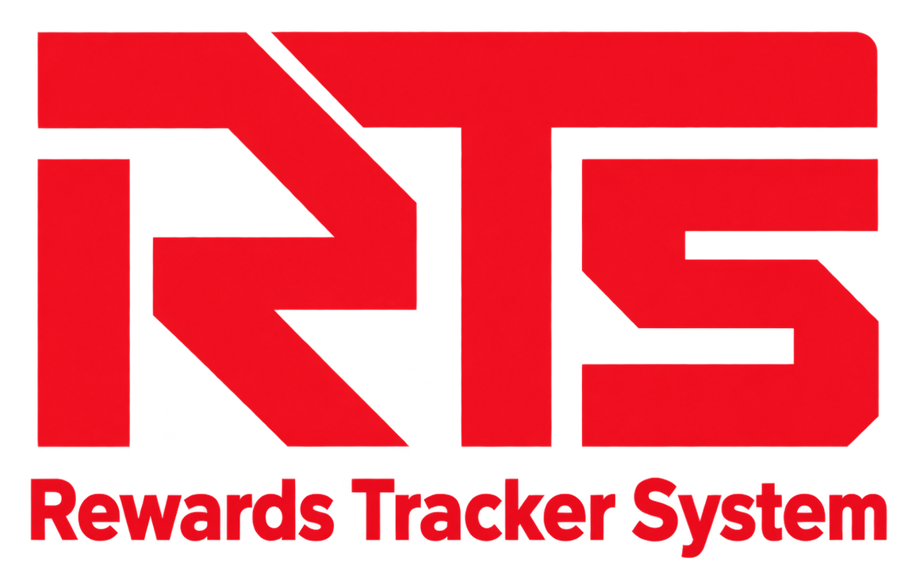
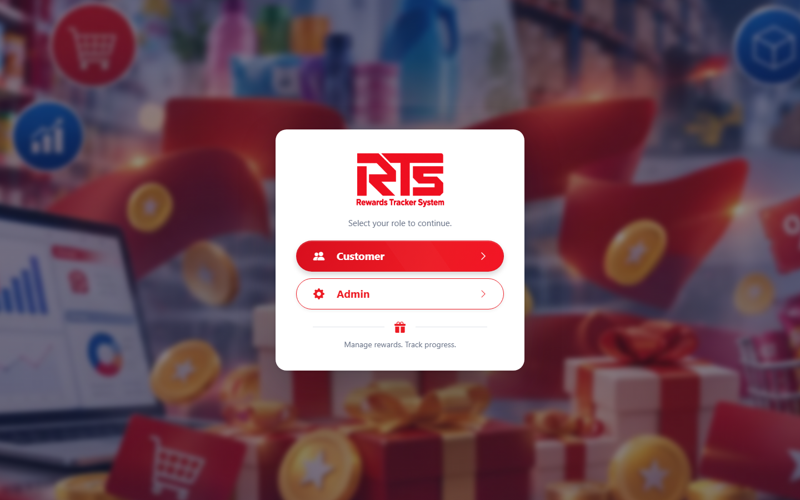
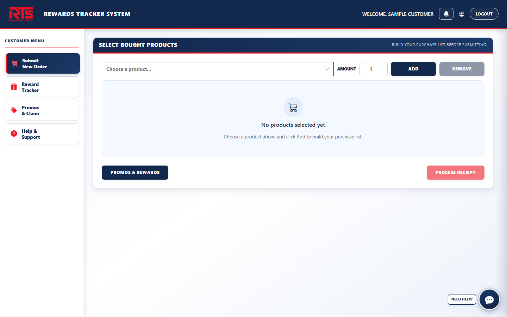
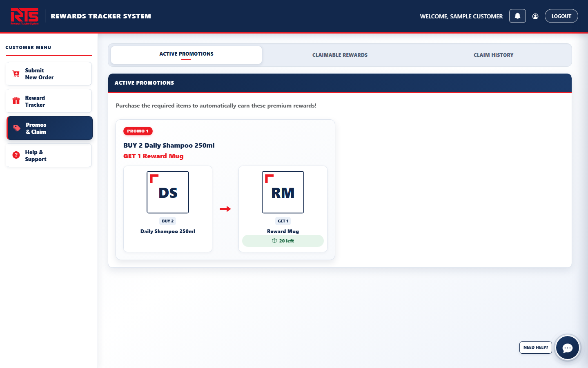
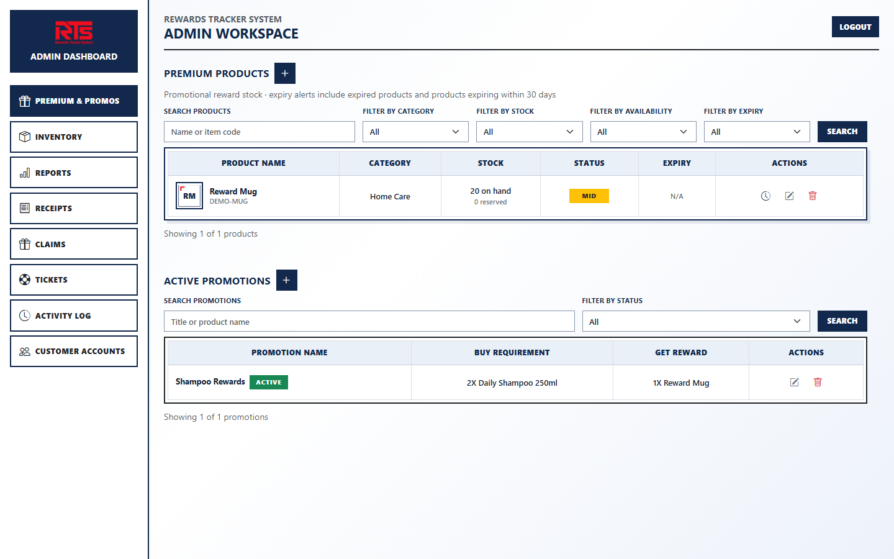
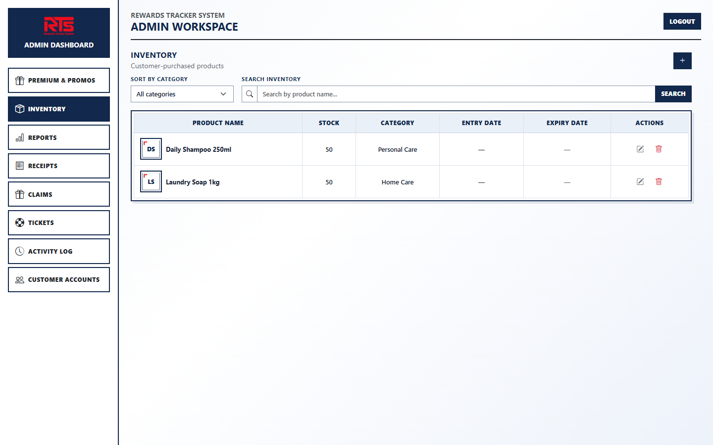

<div align="center">



# Rewards Tracker System

A web application for submitting purchase receipts, managing promotions, and tracking customer rewards.

**[Open the live application](https://laicomrewardstracker.laravel.cloud/)**

</div>



## Overview

Rewards Tracker System (RTS) brings customer order submissions and promotional reward administration into one place. Customers submit their purchased products and receipt images; administrators review submissions, manage promotions and stock, and record reward handovers. Customers can follow the progress of their orders and claims from their dashboard.

The system maintains two separate catalogs:

- **Inventory:** products customers purchase and select when submitting an order.
- **Premium products:** reward items offered through promotions.

RTS is a Laravel capstone project with customer and administrator roles. Order details are submitted through the application and reviewed by staff.

## How it works

1. A customer registers, signs in, and submits an order number, order date, purchased products, quantities, and a receipt image.
2. The system validates the submission and checks for an existing active order with the same normalized number.
3. An administrator reviews the receipt and the qualifying promotion choices, then approves or rejects the order.
4. Approval creates earned reward records and reserves the necessary premium stock.
5. The customer requests a claim code. Staff record the handover, and the customer confirms receipt of the rewards.
6. Notifications, claim history, stock movements, and activity records help both sides track progress.

Claim requests and reward handovers are separate steps. The scheduler processes expired reward claims and expired premium stock.

## Features

### Customer

- Register with CAPTCHA verification and sign in to a personal dashboard.
- Submit orders with product quantities and a receipt image.
- Track order review, view active promotions, and see earned rewards.
- Request claim codes, confirm received rewards, and review claim history.
- Receive notifications and contact support through tickets and attachments.
- Manage account information and password settings.

### Administrator

- Manage purchased-product inventory, premium products, stock, and promotions.
- Review submitted receipts, qualifying rewards, and possible duplicate slips.
- Approve or reject orders and process reward handovers.
- Respond to support tickets and add internal notes.
- View activity history and generate promotion, premium stock, and inventory movement reports with CSV or XLSX export.
- Manage customer account recovery.

The customer and administrator interfaces use periodic requests to update relevant counts and dashboard information. Active support conversations check for new replies while open.

## Screenshots

These screenshots were captured from the current application using an isolated local database and sample data. They do not show real customer records.

| Customer dashboard | Active promotions |
| --- | --- |
|  |  |

| Premium products and promotions | Purchased-product inventory |
| --- | --- |
|  |  |

## Technology

| Area | Technology |
| --- | --- |
| Backend | PHP 8.2+, Laravel 12, Eloquent |
| Database | MySQL; SQLite is used for the automated test suite |
| Frontend | Blade, Bootstrap 5, Bootstrap Icons, custom CSS, vanilla JavaScript |
| API | Laravel Sanctum token authentication |
| Other | CAPTCHA integration, Laravel Excel for report exports, GD for receipt images |

The main application views load the project's Bootstrap and custom assets directly. Vite and Tailwind starter files are also present.

## Project structure

The Laravel application is in the `lrts/` directory.

```text
lrts/
├── app/Http/Controllers/     Customer, admin, authentication, and API controllers
├── app/Models/               Eloquent models and relationships
├── app/Services/             Receipt, reward, claim, stock, and other business rules
├── config/                   Application, storage, CAPTCHA, and business settings
├── database/                 Migrations, factories, and seeders
├── public/                   CSS, JavaScript, images, and vendor assets
├── resources/views/          Blade layouts, pages, and components
├── routes/                   Web, API, and scheduled console routes
├── tests/                    Feature, unit, browser, and load-test code
└── docs/                     Deployment notes and screenshots
```

Important workflows include `ReceiptSubmissionService`, `RewardCalculator`, `ClaimService`, and `PremiumStockLedger`. Receipt images and support attachments use private storage and are served through authorized routes.

## Local setup

### Requirements

- PHP 8.2 or later with GD, ZIP, PDO, and the database driver required by your setup.
- Composer and MySQL.
- Node.js and npm if working with Vite-managed assets or the Node-based browser checks.

### Installation

Clone the repository and enter the Laravel application directory:

```bash
git clone https://github.com/GhostOfCharles/laicom-rewards-tracker.git
cd laicom-rewards-tracker/lrts
composer install
```

Create a local `.env` file from `.env.example`, configure your local database, and generate a key for the **new installation**:

```bash
cp .env.example .env
php artisan key:generate
php artisan migrate
php artisan storage:link
```

On Windows, `copy .env.example .env` can be used instead of `cp`. Configure the CAPTCHA provider and keys for the environment where registration will run. The local seeder can add sample catalog records:

```bash
php artisan db:seed
```

Create an administrator using the interactive command; the password is entered through hidden prompts:

```bash
php artisan lrts:make-admin admin@example.com "Administrator"
```

Start the application:

```bash
php artisan serve
```

Open `http://127.0.0.1:8000`. Run the scheduler during local development when testing expiry workflows:

```bash
php artisan schedule:work
```

For a new local installation, the application defaults in `config/lrts.php` specify a 30-day claim window, a 60-day maximum order age, and a 10 MB receipt-image limit. Verify your environment and configuration before relying on these values.

## Testing

From the `lrts/` directory:

```bash
php artisan test
node tests/Browser/polling-smoke.cjs
```

The default PHPUnit configuration uses an in-memory SQLite database. MySQL concurrency checks require a separate, dedicated test database; see [deployment and verification notes](lrts/docs/DEPLOYMENT.md). Browser and load-testing scripts are available under `lrts/tests/` and may require additional local setup.

## Deployment and data

Use HTTPS, disable debug mode, configure the database and CAPTCHA, and run the Laravel scheduler on the host. Receipt images and support attachments must remain private. On hosts with ephemeral storage, configure and verify durable storage for uploads before relying on it.

Back up the database and uploaded files, and rehearse restoration in an isolated environment. Do not reset a database containing real records. See [deployment and recovery](lrts/docs/DEPLOYMENT.md) for storage, backup, scheduler, and verification details.

Keep `.env` files, credentials, customer data, and private uploads out of source control.