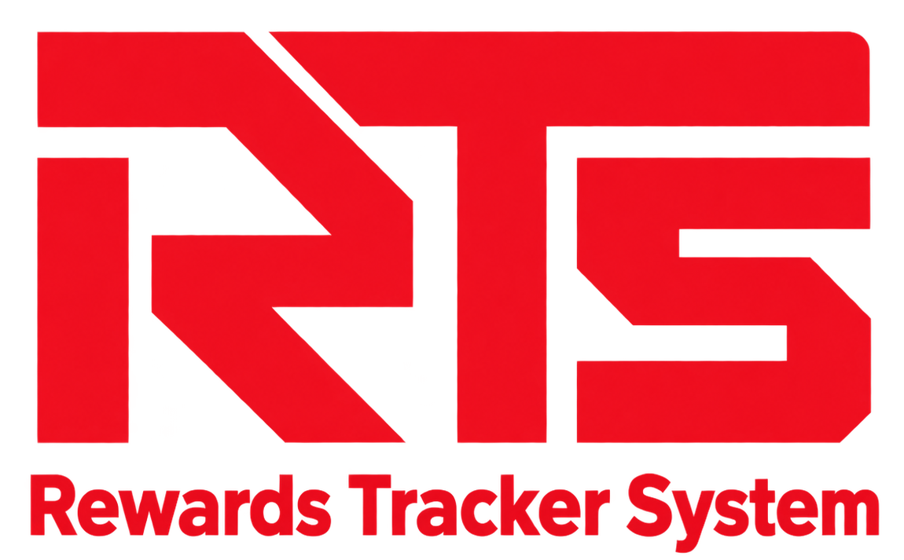

<div align="center">



# Rewards Tracker System (RTS)

**A Customer Order and Promotional Rewards Management Platform**

Developed as a capstone project for promotional rewards administration.

A responsive web application for managing customer orders, evaluating promotional rewards, tracking claims, and maintaining reward inventory.

</div>

---

## Contents

1. [Overview](#overview)
2. [How It Works](#how-it-works)
3. [Roles and Features](#roles-and-features)
4. [Application Pages](#application-pages)
5. [Architecture](#architecture)
6. [Data Model](#data-model)
7. [Technology and Open-Source Software](#technology-and-open-source-software)
8. [Project Structure](#project-structure)
9. [Screenshots](#screenshots)
10. [Local Setup](#local-setup)
11. [Configuration](#configuration)
12. [Running the App](#running-the-app)
13. [Testing](#testing)
14. [Security and Deployment](#security-and-deployment)
15. [Known Test Status](#known-test-status)

---

## Overview

**Rewards Tracker System (RTS)** is a Laravel-based web application designed to centralize customer order submissions, promotional reward eligibility, reward inventory management, and customer support.

The system allows customers to submit purchase details and track earned promotional rewards, while administrators review orders, verify eligibility, manage reward stock, and process claims.

When an order is approved, the system creates the corresponding reward records and reserves the required premium-product stock.

### Product Catalogs

RTS maintains two separate catalogs:

- **Inventory:** Customer-purchased products used when submitting order details.
- **Premium Products:** Promotional reward items distributed to eligible customers.

### User Roles

The application supports two primary roles:

- **Customer:** Submits orders, tracks promotional rewards, manages claims, and contacts support.
- **Administrator:** Reviews orders, manages products and promotions, oversees reward claims, and monitors system activities.

There is no separate salesman role or direct point-of-sale integration in the current Laravel application. Customer order information is submitted through the web dashboard or API and reviewed by administrators.

---

## How It Works

1. **Customer Registration:** A customer creates an account with CAPTCHA verification and signs in.
2. **Order Submission:** The customer provides an order number, order date, purchased products, quantities, and a receipt image.
3. **Order Validation:** The system normalizes order numbers, checks for duplicate active submissions, and validates order information.
4. **Administrator Review:** An administrator reviews the submitted receipt and checks qualifying promotions.
5. **Reward Approval:** Eligible rewards are recorded and the corresponding premium-product stock is reserved.
6. **Reward Claim:** The customer requests a claim code, staff confirm physical handover, and the customer confirms receipt.
7. **Activity Recording:** The system records notifications, stock movements, and audit events.
8. **Expiration Handling:** Scheduled tasks process overdue reward claims and expired premium stock.

Rejected or cancelled order numbers may be submitted again.

### Business Rules

Important limits are configurable in `config/lrts.php`.

| Setting | Value |
|---|---|
| Reward claim window | 30 days |
| Maximum order age | 60 days |
| Receipt image upload limit | 10 MB |

These values should be verified against the current configuration before deployment.

---

## Roles and Features

### Customer

Customers can:

- Register with CAPTCHA verification.
- Sign in to a personal dashboard.
- Submit orders with purchased products and receipt images.
- Track order statuses: Processing, Approved, Rejected, or Cancelled.
- View available promotional offers.
- Track earned rewards and claim codes.
- Review reward claim history.
- Confirm reward receipt after staff handover.
- Receive system notifications.
- Create support tickets with attachments.
- Communicate with the support team.

### Administrator

Administrators can:

- Manage premium reward products, quantities, categories, images, and expiry information.
- Manage the customer-purchased product inventory.
- Create and update promotional offers.
- Configure purchase requirements and corresponding rewards.
- Review customer receipt submissions.
- Approve or reject submitted orders.
- Select qualifying promotional rewards.
- Manage reward claims and physical handovers.
- Monitor premium stock movements.
- Handle customer support tickets and internal notes.
- View activity logs.
- Generate filtered reports.
- Export reports in CSV and XLSX formats.

---

## Application Pages

| Route | Page | Description |
|---|---|---|
| `/` | Portal | Entry point for customer and administrator authentication |
| `/login` | Customer Login | Customer authentication |
| `/register` | Registration | Customer account registration with CAPTCHA |
| `/admin/login` | Admin Login | Administrator authentication |
| `/dashboard` | Customer Dashboard | Order submission, rewards, promotions, claims, and support |
| `/admin/dashboard` | Admin Dashboard | Premium products and promotion management |
| `/admin/inventory` | Inventory | Purchased-product catalog management |
| `/admin/receipts` | Receipts | Customer order review and approval |
| `/admin/claims` | Claims | Reward release, confirmation, completion, and expiry |
| `/admin/tickets` | Support Tickets | Customer inquiries and ticket management |
| `/admin/reports` | Reports | Promotion, stock, and inventory reports |
| `/admin/activity-log` | Activity Log | Administrator activity and audit records |
| `/account` | Account settings | Customer profile and secure password change |
| `/notifications` | Notifications | Paginated customer notifications |
| `/admin/customers` | Customer accounts | Audited account recovery |

Premium stock history can be accessed through the corresponding product management actions.

---

## Architecture

RTS follows a **Laravel MVC architecture** with dedicated service classes for reusable business logic.

```text
Customer / Admin Browser         API Client
           |                         |
           +------ Laravel Routes ---+
                       |
                web.php / api.php
                       |
           Authentication & Middleware
                       |
                   Controllers
                       |
              Application Services
          (Receipts, Rewards, Claims,
               Stock, Auditing)
                       |
                 Eloquent Models
                       |
             MySQL & File Storage
                       |
             Blade Views / JSON API
```

### Architectural Components

**Routes**
- Web routes use Laravel session authentication.
- API routes use Laravel Sanctum token authentication.

**Controllers**
- Handle incoming requests, validation, and HTTP responses.

**Services**
- Contain reusable business logic for receipts, rewards, stock movements, claims, and auditing.

**Models**
- Represent database entities using Laravel Eloquent.

**Views**
- Use Laravel Blade templates for customer and administrator interfaces.

**Database**
- MySQL stores application records and relationships.
- Laravel migrations define and maintain the database schema.

**File Storage**
- Receipt images and support attachments are stored privately.
- Authorized controllers control access to sensitive files.

The API currently includes authentication, user information, and receipt-submission endpoints.

A separate mobile application should only be documented if it is included in the actual project deliverables.

---

## Data Model

The application's primary database tables are:

| Area | Tables | Purpose |
|---|---|---|
| Accounts | `users`, `personal_access_tokens` | User accounts and API authentication |
| Catalogs | `inventories`, `premium_products` | Purchased products and reward items |
| Promotions | `promotions` | Promotion requirements and reward configurations |
| Orders | `receipts`, `receipt_items`, `receipt_order_guards` | Order submissions and duplicate protection |
| Rewards | `earned_rewards` | Earned rewards, claim codes, and lifecycle states |
| Stock | `stock_movements`, `premium_stock_movements` | Stock transaction history |
| Support | `tickets`, `ticket_replies` | Customer support conversations |
| Notifications | `customer_notifications` | Customer notifications |
| Auditing | `activity_logs` | System activity records |
| Laravel Support | `sessions`, `password_reset_tokens`, `cache`, `jobs`, `failed_jobs` | Framework support |

### Database Relationships

The main relationships include:

- One customer can submit multiple receipts.
- One receipt can contain multiple purchased products.
- One receipt can generate multiple earned rewards.
- One customer can create multiple support tickets.
- One ticket can contain multiple replies.
- Products can have multiple stock movement records.
- Promotions reference premium reward products.
- Activity logs record actions related to different entities.

For database documentation and ERD creation, use the current migrations in `database/migrations` as the authoritative schema reference.

---

## Technology and Open-Source Software

### Application Stack

| Technology | Purpose |
|---|---|
| PHP 8.2+ | Server-side application runtime |
| Laravel 12 | Backend framework |
| MySQL 8 | Relational database |
| Blade | Server-rendered templates |
| Bootstrap 5.3.0 | Responsive UI components |
| Bootstrap Icons 1.11.1 | Interface icons |
| Vanilla JavaScript | Frontend interactions |
| Custom CSS | System-specific design and styling |
| Composer | PHP dependency management |

### Additional Packages

| Package / Service | Purpose |
|---|---|
| Laravel Sanctum 4.3 | API authentication |
| edulazaro/laracaptcha 1.0 | CAPTCHA integration |
| Laravel Excel 3.1 | CSV and XLSX export |
| Cloudflare Turnstile | Registration bot protection |
| PHPUnit 11 | Automated testing |

### Frontend Assets

The main interfaces use Bootstrap, Bootstrap Icons, custom CSS, and JavaScript.

The repository also contains Vite and Tailwind starter files. Their actual usage should be verified before treating them as active frontend dependencies.

Open-source libraries retain their respective licensing requirements.

---

## Project Structure

```text
app/
├── Exports/                     Report exports
├── Http/
│   ├── Controllers/
│   │   ├── Admin/               Administrator workflows
│   │   ├── Api/                 API endpoints
│   │   └── Auth/                Web authentication
│   └── Middleware/              Access control
├── Models/                      Database models
└── Services/                    Business logic

config/
└── lrts.php                     Business settings

database/
├── migrations/                  Database schema
└── seeders/                     Demo data

public/
├── css/                         Application styles
└── images/                      RTS branding and UI images

resources/
└── views/
    ├── admin/                   Administrator interfaces
    ├── auth/                    Authentication pages
    ├── customer/                Customer dashboard
    └── layouts/                 Shared layouts

routes/
├── web.php                      Browser routes
├── api.php                      API routes
└── console.php                  Scheduled commands

storage/
└── app/
    └── private/                 Protected uploads

tests/
├── Feature/                     Integration and workflow tests
└── Unit/                        Unit tests
```

Some internal filenames may retain legacy naming conventions. Those paths should be verified against the current repository before renaming, since changing asset paths without updating their references could break the application.

---

## Screenshots

Application screenshots can be added to the repository under a dedicated documentation directory.

Suggested structure:

```text
docs/
└── screenshots/
    ├── portal.png
    ├── customer-dashboard.png
    ├── reward-tracker.png
    ├── admin-dashboard.png
    └── reports.png
```

Only use authorized screenshots with sensitive customer information removed.

---

## Local Setup

### Prerequisites

Install the following:

- [PHP 8.2 or later](https://windows.php.net/download)
- [Composer](https://getcomposer.org/download)
- [Node.js 18+](https://nodejs.org)
- [MySQL 8](https://dev.mysql.com/downloads)
- [Git](https://git-scm.com)

### Required PHP Extensions

Enable the following extensions in `php.ini`:

```ini
extension=gd
extension=zip
extension=pdo_mysql
```

These extensions support image processing, Excel exports, and MySQL connectivity.

Restart your server or terminal after updating the configuration.

### Clone the Repository

```bash
git clone <repository-url> rts
cd rts
```

Replace `<repository-url>` with the actual GitHub repository URL.

### Install Dependencies

```bash
composer install
```

If the frontend asset pipeline is required:

```bash
npm install
```

### Configure Environment

Create the `.env` file.

**Windows:**

```powershell
copy .env.example .env
```

**macOS / Linux:**

```bash
cp .env.example .env
```

Generate the application key:

```bash
php artisan key:generate
```

Never commit the `.env` file or actual credentials.

### Create the Database

Create a MySQL database named `lrts`:

```sql
CREATE DATABASE lrts
CHARACTER SET utf8mb4
COLLATE utf8mb4_unicode_ci;
```

### Configure Database Connection

Update `.env`:

```env
DB_CONNECTION=mysql
DB_HOST=127.0.0.1
DB_PORT=3306
DB_DATABASE=lrts
DB_USERNAME=root
DB_PASSWORD=your_mysql_password
```

### Run Database Migrations

```bash
php artisan migrate --seed
```

The seeder may create development accounts and sample catalog records.

Do not use demo credentials in production.

### Configure Storage

```bash
php artisan storage:link
```

This creates the public storage link for assets intended to be publicly accessible.

Sensitive receipt images and support attachments must remain in private storage.

### Build Assets

If the Vite build pipeline is active:

```bash
npm run build
```

### Clear Application Caches

```bash
php artisan config:clear
php artisan view:clear
php artisan route:clear
php artisan cache:clear
```

---

## Configuration

Application settings are managed through the `.env` file.

| Variable | Description |
|---|---|
| `APP_NAME` | Application name |
| `APP_ENV` | Application environment |
| `APP_KEY` | Application encryption key |
| `APP_DEBUG` | Debug mode |
| `APP_URL` | Application URL |
| `DB_CONNECTION` | Database driver |
| `DB_HOST` | Database host |
| `DB_PORT` | Database port |
| `DB_DATABASE` | Database name |
| `DB_USERNAME` | Database username |
| `DB_PASSWORD` | Database password |
| `CAPTCHA_DRIVER` | CAPTCHA provider |
| `TURNSTILE_KEY` | Turnstile site key |
| `TURNSTILE_SECRET` | Turnstile secret key |

### Example Local Configuration

```env
APP_NAME="Rewards Tracker System"
APP_ENV=local
APP_DEBUG=true
APP_URL=http://127.0.0.1:8000

DB_CONNECTION=mysql
DB_HOST=127.0.0.1
DB_PORT=3306
DB_DATABASE=lrts
DB_USERNAME=root
DB_PASSWORD=your_mysql_password_here

CAPTCHA_DRIVER=turnstile
TURNSTILE_KEY=1x00000000000000000000AA
TURNSTILE_SECRET=1x0000000000000000000000000000AA
```

The Turnstile credentials above are intended for local development testing only.

Use real environment-specific credentials in deployed environments.

Never expose production secrets in documentation or source control.

---

## Running the App

Start the local Laravel development server:

```bash
php artisan serve
```

Open:

```text
http://127.0.0.1:8000
```

### Testing on Another Device

To test on a phone connected to the same network, run:

```bash
php artisan serve --host=0.0.0.0 --port=8000
```

Find your computer's local IPv4 address.

On Windows:

```powershell
ipconfig
```

For example, if your computer's local IP is `192.168.1.45`, access the application through:

```text
http://192.168.1.45:8000
```

Make sure:

- Both devices use the same local network.
- Windows Firewall permits the connection.
- Router client isolation is not blocking communication.
- The correct local IPv4 address and port are used.

Do not expose the development server directly to the public internet.

### Scheduled Tasks

For local scheduled task testing:

```bash
php artisan schedule:work
```

### CAPTCHA Testing on Mobile

Cloudflare Turnstile may reject unsupported local network origins.

For temporary local testing, use an explicitly supported development configuration.

Alternatively, use an HTTPS tunnel such as:

- [ngrok](https://ngrok.com)
- [Cloudflare Tunnel](https://developers.cloudflare.com/cloudflare-one/connections/connect-networks/)

Configure the appropriate allowed hostname with the CAPTCHA provider.

Never disable CAPTCHA protection in a public production environment.

---

## Quick Setup Commands

```bash
git clone <repository-url> rts
cd rts

composer install

cp .env.example .env
php artisan key:generate

# Configure the MySQL database in .env

php artisan migrate --seed
php artisan storage:link

php artisan serve
```

If frontend building is required:

```bash
npm install
npm run build
```

---

## Testing

Run the automated test suite:

```bash
php artisan test
```

The current PHPUnit configuration uses an in-memory SQLite database for automated testing.

The local application is configured to use MySQL.

### Recommended Testing Areas

- Authentication and authorization
- Customer registration
- Order submission and validation
- Duplicate order prevention
- Promotional reward qualification
- Administrator receipt approval
- Reward stock reservation
- Claim requests and handover
- Customer receipt confirmation
- Expired reward handling
- Support tickets
- Reports and exports
- API access restrictions

Database concurrency behavior should also be verified using MySQL before a production release.

---

## Security and Deployment

Before deployment:

1. Set `APP_ENV=production`.
2. Disable debugging using `APP_DEBUG=false`.
3. Configure HTTPS and the correct `APP_URL`.
4. Secure application secrets and credentials.
5. Remove or replace development accounts and predictable passwords.
6. Configure valid production CAPTCHA credentials.
7. Verify authentication, authorization, and role permissions.
8. Ensure receipt images and attachments remain privately accessible.
9. Configure durable file storage and backups.
10. Configure the Laravel scheduler.
11. Apply database migrations carefully.
12. Verify stock and reward transaction integrity.
13. Test the complete order and reward claim workflow.
14. Confirm that application logs do not expose sensitive data.
15. Verify the production environment after deployment.

Never use `php artisan migrate:fresh` on a database containing production data.

Do not rotate an existing production `APP_KEY` without evaluating its effect on encrypted application data.

### Scheduled Reward Expiration

The reward expiration command is scheduled daily at **00:10**.

The production environment must invoke the Laravel scheduler regularly for expiration processing to work.

### Data Protection

Sensitive information should be protected through:

- Authentication and role-based access controls
- Server-side validation
- Private file storage
- Secure database configuration
- Protected session management
- Audit logging
- Reliable database and file backups

---

## Verification and operations

`php artisan test` runs the SQLite regression suite. MySQL concurrency tests skip unless an isolated existing database named `rts_test_*` is supplied through `RTS_MYSQL_TEST_DATABASE`; they never reset a database. See `docs/DEPLOYMENT.md` for setup, mail/storage configuration, backups, restore drills and polling checks. Current implementation results are recorded in `docs/IMPLEMENTATION_PROGRESS.md`.

The UI uses self-hosted Bootstrap/icons, shared `public/css/rts.css`, Blade components and extracted customer scripts. Admin counters poll every 20 seconds; customer tracking every 30 seconds (60 on other tabs); visible support threads every 10?15 seconds. Polling pauses on hidden/idle pages and only updates safe read-only UI automatically.

Create the initial administrator with `php artisan lrts:make-admin email@example.com "Administrator"`. Production seeding creates no accounts or demo data. Existing accounts are preserved and must be reviewed manually before deployment.

---

## Project Purpose

Rewards Tracker System aims to improve the management of promotional rewards by centralizing customer submissions, administrator reviews, reward tracking, inventory monitoring, and support workflows.

The project focuses on:

- **Efficiency:** Reducing manual processing and repetitive administrative work.
- **Transparency:** Providing customers with visibility into order and reward statuses.
- **Accuracy:** Maintaining reliable promotional reward and stock records.
- **Accountability:** Recording important administrative and transactional activities.
- **Accessibility:** Providing a responsive interface for customers and administrators.
- **Maintainability:** Supporting future improvements through an organized Laravel architecture.

---

<div align="center">

### Rewards Tracker System

**Manage rewards. Track progress.**

Built with Laravel, PHP, MySQL, Bootstrap, and JavaScript.

</div>
